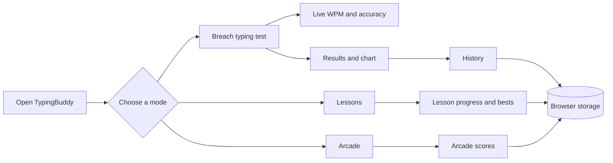
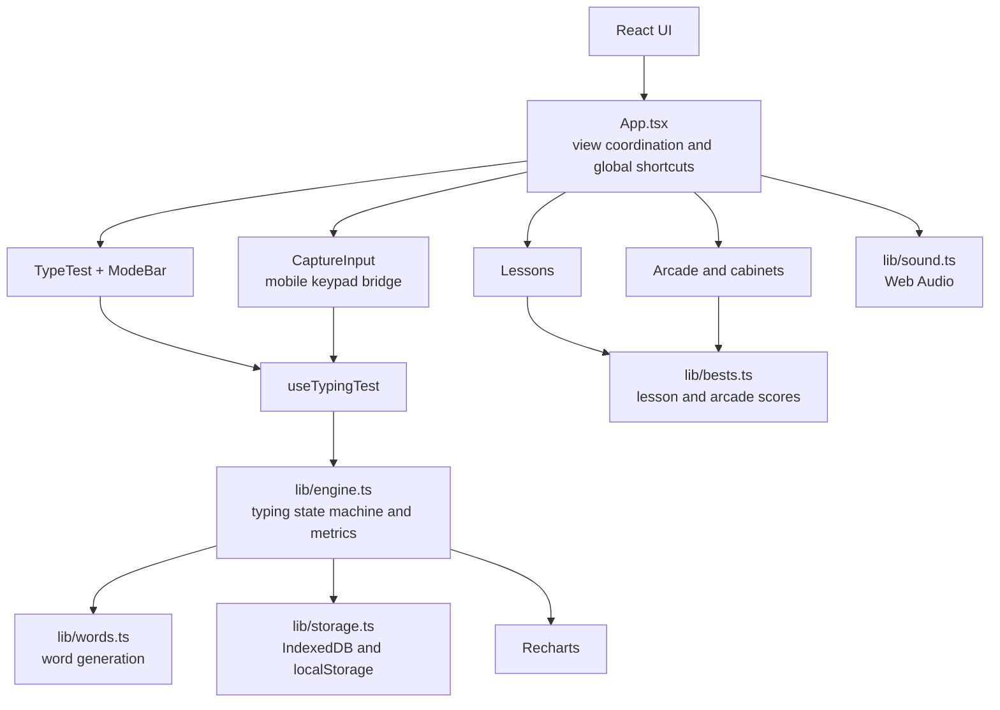
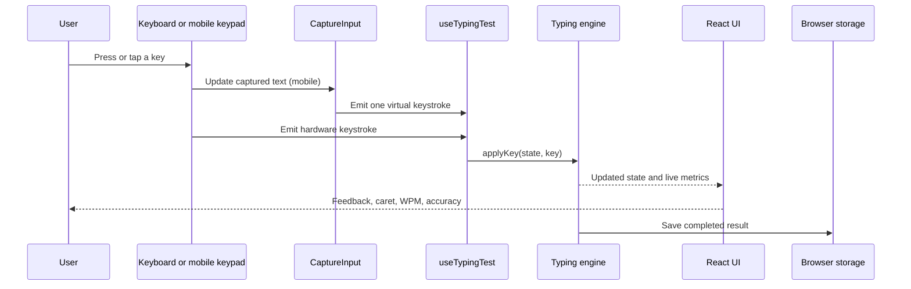

# TypingBuddy

> A terminal-styled typing trainer for improving speed, accuracy, and keyboard
> confidence through timed tests, structured lessons, and arcade games.

[](https://typingbuddy.vercel.app/)

## Live demo

**[Open TypingBuddy](https://typingbuddy.vercel.app/)**

TypingBuddy runs entirely in the browser. No account or backend is required:
test results, settings, lesson bests, and arcade scores are stored locally on
the device using IndexedDB and `localStorage`.

## What it includes

- **Typing tests** with time-based (15, 30, 60, and 120 seconds) and
  word-count (10, 25, 50, and 100 words) modes.
- **Configurable modifiers** for punctuation and numbers.
- **Live metrics** including WPM, raw WPM, accuracy, consistency, progress, and
  per-second performance.
- **Lessons** that progress from home-row drills to reach keys, full keyboard
  practice, words, symbols, and graduation exams.
- **Arcade mode** with eight keyboard-driven games: Invaders, Tracer,
  Pulse-Key, Defuse, Ghost Chase, Word Brawler, Ghost Duel, and Letter Storm.
- **History and personal bests** with trend charts and saved lesson/arcade
  scores.
- **Desktop and mobile support**, including a virtual-keyboard capture flow for
  phones and tablets.
- **Terminal-inspired UI** with CRT scanlines, live telemetry, synthesized
  typewriter sounds, and responsive layouts.

## Screens and flow



## Architecture

TypingBuddy is a client-side React application. The typing engine is kept
separate from the UI so the same state machine can power hardware keyboards,
the mobile capture input, lessons, and results.



## How input is processed



## Tech stack

| Area | Technology |
| --- | --- |
| UI | React 19 + TypeScript |
| Build and dev server | Vite |
| Styling | Tailwind CSS + custom terminal theme |
| Charts | Recharts |
| Client persistence | `idb` with IndexedDB and `localStorage` |
| Audio | Web Audio API |
| Testing | Vitest + Testing Library |
| Linting | oxlint |
| Deployment | Vercel |

## Project structure

```text
.
├── public/                 # Static assets
├── src/
│   ├── App.tsx             # Main composition, navigation, shortcuts, persistence
│   ├── main.tsx            # React entry point
│   ├── index.css           # Global styles and terminal theme
│   ├── components/
│   │   ├── TypeTest.tsx    # Typing area, caret, and live stats
│   │   ├── ModeBar.tsx     # Mode, duration, and modifier controls
│   │   ├── Results.tsx     # Completed-test metrics and chart
│   │   ├── History.tsx     # Saved results, trends, and personal best
│   │   ├── Lessons.tsx     # Lesson curriculum and drills
│   │   ├── Arcade.tsx      # Arcade hall and cabinet host
│   │   ├── CaptureInput.tsx  # Mobile keypad capture bridge
│   │   ├── Header.tsx      # Branding and view navigation
│   │   ├── Footer.tsx      # Keyboard shortcut help
│   │   ├── SystemHud.tsx   # Live telemetry strip
│   │   ├── arcade/         # Invaders, Tracer, Defuse, and other cabinets
│   │   └── dashboard/      # Terminal dashboard widgets and windows
│   ├── hooks/
│   │   └── useTypingTest.ts  # React binding for the typing state machine
│   └── lib/
│       ├── engine.ts       # Test state, key grading, metrics, and results
│       ├── words.ts        # Word pools and test-word generation
│       ├── lessons.ts      # Lesson and chapter curriculum
│       ├── storage.ts      # IndexedDB history and saved settings
│       ├── bests.ts        # Persistent lesson and arcade bests
│       ├── virtualKey.ts   # Mobile input diffing and synthetic key events
│       ├── device.ts       # Touch-device detection
│       └── sound.ts        # Typewriter sounds
├── package.json            # Scripts and dependencies
├── vite.config.ts          # Vite configuration
├── tsconfig*.json          # TypeScript configuration
└── README.md
```

## Getting started

### Prerequisites

- Node.js 20 or newer
- npm

### Install and run locally

```bash
npm install
npm run dev
```

Open the local URL printed by Vite, usually
[`http://localhost:5173`](http://localhost:5173).

### Production build

```bash
npm run build
npm run preview
```

## Available scripts

| Command | Description |
| --- | --- |
| `npm run dev` | Start the Vite development server |
| `npm run build` | Type-check and create a production build |
| `npm run preview` | Preview the production build locally |
| `npm run test` | Run the test suite once |
| `npm run test:watch` | Run tests in watch mode |
| `npm run lint` | Run oxlint |

## Keyboard and touch controls

### Desktop

- Type directly into the active test.
- Press `Tab` or `Escape` to restart.
- Press `Enter` to start the next test after finishing.
- Switching tabs or windows pauses an active test.

### Phone and tablet

Tap the typing area to open the device keyboard. TypingBuddy uses an invisible
capture input to translate edits, backspaces, and keypad autocorrect changes
into the same keystroke stream used by desktop input.

Arcade games use the same touch-input plumbing. A hardware keyboard is
recommended for symbol-heavy games such as Defuse.

## Data and privacy

- No user account or server-side database is needed.
- Test history is stored in IndexedDB.
- Settings, sound preferences, lesson bests, and arcade bests use browser
  storage.
- Clearing site data removes local history and preferences.
- The app does not need network access after its assets have loaded, except for
  externally hosted fonts when available.

## Contributing

1. Create a branch for your change.
2. Install dependencies with `npm install`.
3. Make the smallest focused change.
4. Run `npm run lint`, `npm run test`, and `npm run build`.
5. Open a pull request with a concise description and validation details.

## License

No license has been specified yet.
